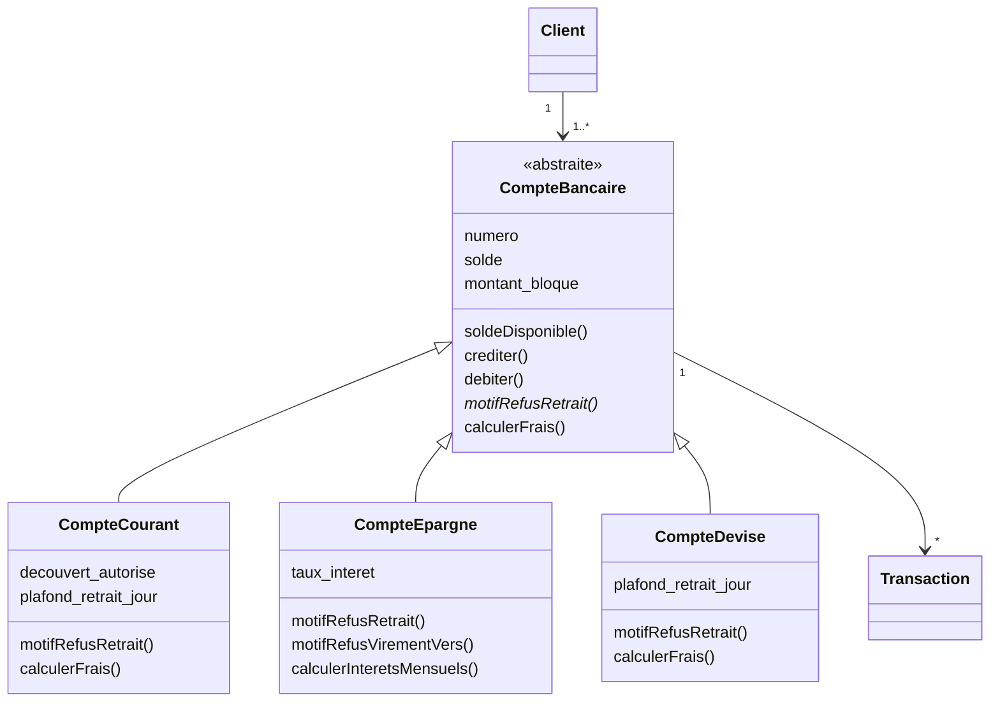
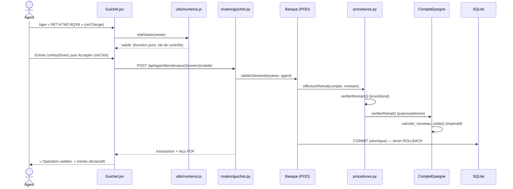

# BankServices — Rapport : les paradigmes de programmation

> TP *Génie Logiciel : paradigmes de programmation* · Application Web de services bancaires
> Backend **Python · FastAPI · SQLAlchemy · SQLite** — Frontend **React 19 · Vite** — Simulateur pédagogique, données fictives.

## Sommaire

1. [Objectif du rapport](#1-objectif-du-rapport)
2. [Les six paradigmes en un coup d'œil](#2-les-six-paradigmes-en-un-coup-dœil)
3. [Arborescence annotée du projet](#3-arborescence-annotée-du-projet)
4. [Chaque paradigme dans le code](#4-chaque-paradigme-dans-le-code)
5. [Un même calcul, trois paradigmes](#5-un-même-calcul-trois-paradigmes)
6. [Les paradigmes travaillent ensemble : un retrait au guichet](#6-les-paradigmes-travaillent-ensemble--un-retrait-au-guichet)
7. [Les tests qui prouvent chaque paradigme](#7-les-tests-qui-prouvent-chaque-paradigme)
8. [Bilan : avantages et limites constatés](#8-bilan--avantages-et-limites-constatés)
9. [Conclusion](#9-conclusion)

---

## 1. Objectif du rapport

Le sujet demande de construire une application bancaire **en utilisant volontairement plusieurs paradigmes de programmation** et de justifier, pour chacun, où et pourquoi il est employé.

BankServices ne met pas un paradigme par dossier « pour cocher une case » : chaque paradigme est placé là où il est **le plus naturel** pour le problème à résoudre.

- Les règles d'un compte (découvert, plafond, limite de retraits) dépendent de son type → **orienté objet**.
- Les statistiques sont des transformations de listes → **fonctionnel** côté code, **déclaratif** côté SQL.
- Le guichet réagit à ce que tape l'agent → **événementiel**.

Ce rapport s'appuie uniquement sur le code réel du dépôt : chaque extrait cité existe dans le fichier indiqué.

---

## 2. Les six paradigmes en un coup d'œil

| Paradigme | Idée centrale | Où dans BankServices | Pourquoi ici |
|---|---|---|---|
| **Impératif** | On dit à la machine **comment** faire, pas à pas : variables modifiées, `if`, boucles `for`. | `backend/app/rules/imperative.py` | Le calcul d'un solde et la décision d'accepter un retrait se lisent comme une suite d'étapes. |
| **Procédural** | Le problème est découpé en **procédures réutilisables** avec des paramètres clairs. | `backend/app/services/procedures.py` | Les 5 fonctions demandées par le sujet (`verifierMontant`, `effectuerDepot`…) sont appelées par l'API, la classe `Banque` et les tests. |
| **Orienté objet** | Des **objets** regroupent données et comportements : encapsulation, héritage, polymorphisme. | `backend/app/domain/`, `backend/app/services/banque.py` | Trois types de comptes partagent un tronc commun mais ont chacun leur règle de retrait. |
| **Fonctionnel** | Des **fonctions pures** : même entrée → même sortie, aucune donnée modifiée ; `filter` / `map` / `reduce`. | `backend/app/functional/`, `frontend/src/utils/` | Frais, conversion, numéros de bordereau et statistiques doivent être exacts et faciles à tester. |
| **Déclaratif** | On décrit **ce que** l'on veut, le moteur décide comment l'obtenir. | SQL (`services/statistiques.py`), composants React, CSS, schémas Pydantic, ORM | Une requête `GROUP BY` ou un tableau React décrit le résultat attendu, pas la boucle. |
| **Événementiel** | Le programme **réagit à des événements** (clic, frappe, requête, expiration de session). | Pages React (`onChange`, `onKeyDown`, `onClick`, `onSubmit`), `auth/Session.jsx`, routes FastAPI | Une interface ne suit pas un ordre fixe : elle attend l'utilisateur. |

---

## 3. Arborescence annotée du projet

Chaque dossier et fichier important est suivi du ou des paradigmes qu'il met en œuvre.

```
Banque_system/
│
├── backend/                                  [POO + Procédurale + Impérative + Fonctionnelle + Déclarative]
│   ├── app/
│   │   ├── main.py                           [Événementielle + Déclarative] application FastAPI, gestionnaires d'erreurs
│   │   ├── database.py                       [Déclarative + POO] DeclarativeBase, type Montant (centimes)
│   │   ├── config.py                         [Déclarative] paramètres par défaut
│   │   ├── errors.py                         [Déclarative + POO] catalogue des messages, ErreurBancaire
│   │   ├── schemas.py                        [Déclarative] schémas Pydantic des entrées / sorties
│   │   │
│   │   ├── domain/                           [Programmation orientée objet]
│   │   │   ├── comptes.py                    [POO] CompteBancaire → CompteCourant, CompteEpargne, CompteDevise
│   │   │   ├── client.py                     [POO] Client (1 client → plusieurs comptes)
│   │   │   ├── operations.py                 [POO] Transaction, DemandeOperation (bordereau)
│   │   │   ├── utilisateur.py                [POO] Utilisateur (accès en ligne, mot de passe)
│   │   │   ├── administration.py             [POO] Parametre, TauxChange, JournalAudit
│   │   │   └── enums.py                      [Déclarative] types d'opérations, statuts, rôles
│   │   │
│   │   ├── rules/
│   │   │   └── imperative.py                 [Impérative] calculer_nouveau_solde, simuler_retrait, totaux_par_boucle
│   │   │
│   │   ├── services/
│   │   │   ├── procedures.py                 [Procédurale] les 5 fonctions du sujet
│   │   │   ├── banque.py                     [POO + Procédurale] classe Banque (façade), virement atomique
│   │   │   ├── acces.py                      [POO + Impérative] ServiceAcces : connexion, verrouillage
│   │   │   ├── statistiques.py               [Déclarative (SQL)] SELECT … GROUP BY
│   │   │   └── numeros.py                    [Impérative] tirage aléatoire des numéros
│   │   │
│   │   ├── functional/                       [Programmation fonctionnelle]
│   │   │   ├── calculs.py                    [Fonctionnelle] frais, conversion de devise, intérêts
│   │   │   ├── stats.py                      [Fonctionnelle] filter / map / reduce
│   │   │   ├── numeros.py                    [Fonctionnelle] clé de contrôle du bordereau
│   │   │   └── lettres.py                    [Fonctionnelle] montant en toutes lettres
│   │   │
│   │   ├── routers/                          [Événementielle + Déclarative] une route = réaction à une requête HTTP
│   │   │   ├── auth.py · clients.py · comptes.py · espace_client.py · admin.py
│   │   │   ├── guichet.py                    [Événementielle] valider / refuser un bordereau
│   │   │   └── convertir.py                  [Procédurale] objets métier → réponses JSON, contrôles d'accès
│   │   │
│   │   ├── security/                         [Procédurale + Impérative] bcrypt, JWT, contrôle des rôles
│   │   ├── pdf/documents.py                  [Procédurale] bordereau, reçu, relevé (ReportLab)
│   │   └── seed.py                           [Procédurale + Impérative] données fictives
│   │
│   └── tests/                                [Procédurale + POO] 7 fichiers Pytest, un par partie du sujet
│
├── frontend/                                 [Déclarative + Événementielle + Fonctionnelle]
│   ├── index.html                            [Déclarative]
│   └── src/
│       ├── main.jsx · App.jsx                [Déclarative] arbre de routes React Router
│       ├── index.css                         [Déclarative] style, jetons de design
│       ├── components/
│       │   ├── Interface.jsx                 [Déclarative] Tableau, Carte, Badge, Alerte, Bordereau
│       │   ├── Layout.jsx                    [Déclarative] menus décrits comme des données
│       │   └── Icone.jsx                     [Déclarative] icônes SVG
│       ├── pages/
│       │   ├── Connexion.jsx                 [Déclarative + Événementielle] onSubmit
│       │   ├── ChangerMotDePasse.jsx         [Événementielle] règles revérifiées à chaque frappe
│       │   ├── DetailCompte.jsx              [Événementielle + Fonctionnelle] filtres → filter/map/reduce
│       │   ├── client/   MesComptes · NouvelleDemande · MesDemandes · Virement · Profil
│       │   ├── agent/    Guichet [Événementielle] · Clients · FicheClient · OperationDirecte
│       │   ├── superviseur/  TableauDeBord · Approbations
│       │   └── admin/    Parametres · Utilisateurs · Audit
│       ├── auth/Session.jsx                  [Événementielle] écoute « session-expiree »
│       ├── api/client.js                     [Événementielle + Procédurale] émet les événements de session
│       ├── hooks/useDonnees.js               [Déclarative + Événementielle] chargement des données
│       ├── utils/                            [Fonctionnelle] montants.js, stats.js, numeros.js, motDePasse.js
│       ├── i18n/                             [Déclarative + Fonctionnelle] dictionnaires fr / en / ar, traduire()
│       └── __tests__/                        [Fonctionnelle + Événementielle] Vitest + Testing Library
│
└── docs/                                     [Documentation] étude, diagrammes, ce rapport
```

---

## 4. Chaque paradigme dans le code

### 4.1 Paradigme impératif

**Définition.** Le programme est une suite d'instructions qui **modifient l'état** (des variables) pas à pas. Le développeur décide de l'ordre exact des opérations avec des conditions et des boucles.

**Où.** `backend/app/rules/imperative.py`. Exemple tiré du sujet : solde 50 000 DA, retrait 12 000 DA.

```python
def simuler_retrait(solde, montant, decouvert_autorise=Decimal("0")) -> dict:
    accepte = False
    nouveau_solde = solde
    message = ""

    if montant <= 0:
        message = "Refusé : le montant doit être strictement positif."
    elif montant > solde + decouvert_autorise:
        message = f"Refusé : solde insuffisant ({solde} DA disponibles)."
    else:
        accepte = True
        nouveau_solde = solde - montant
        message = f"Retrait de {montant} DA accepté. Nouveau solde : {nouveau_solde} DA."

    return {"accepte": accepte, "nouveau_solde": nouveau_solde, "message": message}
```

**Justification.**
- Trois variables (`accepte`, `nouveau_solde`, `message`) sont modifiées selon le chemin pris dans le `if / elif / else` : c'est l'état mutable typique de l'impératif.
- `totaux_par_boucle()` parcourt les transactions avec un `for` et cumule dans des compteurs.
- C'est aussi `calculer_nouveau_solde()`, appelée par toutes les classes de comptes : le cœur du calcul reste volontairement simple et lisible.

### 4.2 Paradigme procédural

**Définition.** On **découpe** le problème en procédures (fonctions) nommées, chacune avec des paramètres définis et un résultat exploitable. Le programme principal enchaîne des appels.

**Où.** `backend/app/services/procedures.py` contient exactement les 5 fonctions demandées par le sujet (partie B) : `verifierMontant()`, `calculerSolde()`, `effectuerDepot()`, `effectuerRetrait()`, `calculerTotalOperations()`.

```python
def effectuerRetrait(compte, montant, contexte=None,
                     libelle="Retrait d'espèces", agent_id=None) -> Transaction:
    """Vérifie le montant et la règle de retrait du compte, débite et renvoie la transaction."""
    valeur = verifierMontant(montant)
    compte.verifierActif()
    compte.verifierRetrait(valeur, contexte)  # règle polymorphe selon le type de compte
    return compte.debiter(valeur, TypeOperation.RETRAIT, libelle, agent_id)
```

**Justification.**
- `effectuerRetrait` ne réécrit rien : elle **enchaîne des procédures** déjà existantes (vérifier le montant → vérifier le compte → débiter).
- `verifierMontant` est réutilisée par le dépôt, le retrait, le virement et la création de bordereau : une seule règle pour les contraintes 3 (montant > 0) et 8 (2 décimales).
- Chaque procédure est testée isolément (`tests/test_imperatif_procedural.py`).

### 4.3 Paradigme orienté objet (POO)

**Définition.** Le programme est organisé autour d'**objets** qui regroupent des données (attributs) et des comportements (méthodes). Trois piliers : **encapsulation**, **héritage**, **polymorphisme**.

**Où.** `backend/app/domain/` (classes métier, aussi tables de la base via SQLAlchemy) et `backend/app/services/banque.py` (classe `Banque`).



**Polymorphisme** : la même méthode `motifRefusRetrait()` a une règle différente dans chaque classe.

```python
class CompteCourant(CompteBancaire):
    def motifRefusRetrait(self, montant, contexte):
        if montant > self.soldeDisponible() + self.decouvert_autorise:   # découvert autorisé
            return "SOLDE_INSUFFISANT"
        ...

class CompteEpargne(CompteBancaire):
    def motifRefusRetrait(self, montant, contexte):
        if contexte.retrait_especes and contexte.retraits_ce_mois >= self.RETRAITS_MAX_MOIS:
            return "LIMITE_RETRAITS_EPARGNE"                             # 2 retraits / mois
        if self.soldeDisponible() - montant < self.SOLDE_MINIMUM:
            return "SOLDE_MINIMUM_EPARGNE"                               # 1 000 DA minimum
        ...
```

**Justification.**
- **Encapsulation** : le solde n'est jamais modifié directement ; tout passe par `crediter()` / `debiter()`, qui vérifient que le compte est actif et enregistrent la transaction.
- **Héritage** : `CompteCourant`, `CompteEpargne` et `CompteDevise` réutilisent tout le comportement commun de `CompteBancaire` (abstraite : on ne crée jamais un « compte » sans type).
- **Polymorphisme** : `effectuerRetrait()` et `Banque.virement()` appellent `compte.verifierRetrait()` sans savoir quel type de compte ils manipulent. Ajouter un quatrième type de compte ne demanderait aucune modification de ces fonctions.
- La classe **`Banque`** est une façade : elle regroupe toutes les opérations (clients, comptes, bordereaux, virements) et garantit l'atomicité avec `atomique()` (COMMIT ou ROLLBACK).

### 4.4 Paradigme fonctionnel

**Définition.** On calcule avec des **fonctions pures** : le résultat ne dépend que des arguments, rien n'est modifié à l'extérieur (pas de base de données, pas d'heure courante). On compose des fonctions et on utilise `filter`, `map`, `reduce` plutôt que des boucles qui modifient des variables.

**Où.**
- Côté serveur : `backend/app/functional/` (frais, conversion, intérêts, clé de contrôle, montant en lettres, statistiques).
- Côté navigateur : `frontend/src/utils/` (montants exacts en centimes, statistiques de l'écran du compte, vérification du numéro de bordereau).

```python
# backend/app/functional/calculs.py — composition de fonctions pures
def frais_proportionnels(montant, taux, minimum, maximum):
    """Frais = taux × montant, bornés entre un minimum et un maximum."""
    return arrondir(borner(montant * taux, minimum, maximum))

def frais_virement_courant(montant):
    """Compte courant : 0,5 % du montant, minimum 50 DA, maximum 1 000 DA."""
    return frais_proportionnels(montant, Decimal("0.005"), Decimal("50"), Decimal("1000"))
```

```js
// frontend/src/utils/stats.js — reduce() sans modifier l'accumulateur
export const totauxParType = (operations) =>
  operations.reduce((acc, op) => ({ ...acc, [op.type]: (acc[op.type] ?? 0) + enCentimes(op.montant) }), {})
```

**Justification.**
- **Fiabilité** : un calcul de frais ou de conversion donne toujours le même résultat, ce qui se teste en une ligne.
- **Précision** : les montants sont manipulés en `Decimal` côté Python et en **centimes entiers** côté JavaScript (`0.1 + 0.2 !== 0.3` en JS) : contrainte 8 du sujet.
- **Le même algorithme des deux côtés** : `cle_controle()` (Python) et `cleControle()` (JS) calculent la clé du numéro de bordereau. Le navigateur détecte la faute de frappe **pendant la saisie**, le serveur refait la vérification.
- La partie **non pure** (tirer un numéro au hasard) est volontairement isolée dans `services/numeros.py` : le fonctionnel ne contient que ce qui est vraiment pur.
- `montant_en_lettres()` (« douze mille dinars », imprimé sur les bordereaux PDF) est construit en **composant** de petites fonctions pures (`_moins_de_cent`, `_moins_de_mille`, `nombre_en_lettres`).

### 4.5 Paradigme déclaratif

**Définition.** On décrit **le résultat voulu**, sans écrire l'algorithme. C'est un moteur (SGBD, React, navigateur, Pydantic) qui décide comment l'obtenir.

**Où, et sous quatre formes :**

| Forme | Fichier | Ce qui est décrit |
|---|---|---|
| **SQL** | `backend/app/services/statistiques.py` | « la somme des montants par type », « crédits et débits par mois » |
| **Interface React** | `frontend/src/components/Interface.jsx`, toutes les pages | ce que l'écran doit afficher selon les données |
| **Validation et modèle** | `backend/app/schemas.py` (Pydantic), `database.py` (`DeclarativeBase`) | la forme des données reçues / renvoyées, les tables |
| **Style** | `frontend/src/index.css` | l'apparence, sans dire comment dessiner |

```sql
-- backend/app/services/statistiques.py
SELECT type,
       COUNT(*)     AS nombre,
       SUM(montant) AS total_centimes
FROM   transactions
WHERE  compte_id = :compte_id AND date >= :debut AND date <= :fin
GROUP  BY type
ORDER  BY total_centimes DESC
```

```jsx
// frontend/src/pages/client/MesComptes.jsx (extrait simplifié) — on décrit les colonnes, le composant construit le tableau
<Tableau
  lignes={enCours}
  vide={t('Aucun bordereau en attente.')}
  colonnes={[
    { cle: 'numero_bordereau', titre: t('Numéro') },
    { cle: 'montant', titre: t('Montant'), droite: true, rendu: (d) => <Montant valeur={d.montant} devise={d.devise} /> },
    { cle: 'statut', titre: t('Statut'), rendu: (d) => <Badge statut={d.statut} /> },
  ]}
/>
```

**Justification.**
- La requête SQL ne parcourt aucune ligne à la main : c'est SQLite qui choisit comment regrouper. Elle donne le **même résultat** que la boucle impérative de `totaux_par_boucle()` (voir §5).
- En React, on ne manipule jamais le DOM : quand les données changent, React recalcule l'affichage. Le composant `Tableau` est réutilisé 10 fois, sur 9 écrans.
- Les menus de chaque rôle (`Layout.jsx`) et les traductions (`i18n/en.js`, `i18n/ar.js`) sont de simples **données** : ajouter un lien ou une langue ne demande aucun code.

### 4.6 Paradigme événementiel

**Définition.** Le programme n'avance pas selon un ordre fixe : il **attend des événements** (clic, frappe, requête réseau, expiration) et exécute le **gestionnaire** associé.

**Où.**
- **Interface** : plus de 90 gestionnaires `onChange`, `onClick`, `onSubmit`, `onKeyDown`, `onBlur` dans les pages React. L'écran le plus représentatif est le guichet (`pages/agent/Guichet.jsx`).
- **Événements applicatifs** : `api/client.js` **émet** `session-expiree`, et `auth/Session.jsx` **l'écoute** pour déconnecter l'utilisateur.
- **Serveur** : chaque route FastAPI est un gestionnaire déclenché par une requête HTTP (ex. `@routeur_agent.post("/bordereaux/{numero}/valider")`).

```jsx
// frontend/src/pages/agent/Guichet.jsx
// chaque frappe (onChange) revérifie la clé de contrôle, Entrée (onKeyDown) lance la recherche
<input value={saisie} onChange={(e) => setSaisie(e.target.value)} onKeyDown={surTouche} />

const surTouche = (evenement) => {
  if (evenement.key === 'Enter') {
    evenement.preventDefault()
    rechercher()
  }
}
```

```js
// émetteur : frontend/src/api/client.js
window.dispatchEvent(new CustomEvent('session-expiree', { detail: erreur.message }))

// récepteur : frontend/src/auth/Session.jsx
window.addEventListener('session-expiree', surExpiration)
```

**Justification.**
- Au guichet, l'agent peut taper, corriger, appuyer sur Entrée, cocher « pièce d'identité vérifiée », puis Accepter ou Refuser **dans l'ordre qu'il veut** : seul l'événementiel décrit bien ce fonctionnement.
- Le bouton « Accepter » n'est actif qu'après l'événement « case cochée » : la règle métier (vérifier l'identité) est appliquée par l'interface elle-même.
- L'émetteur (`client.js`) ne connaît pas le récepteur (`Session.jsx`) : n'importe quel appel à l'API peut déclencher la déconnexion sans que les pages s'en occupent.

---

## 5. Un même calcul, trois paradigmes

Le projet calcule **le total des opérations par type** de trois façons différentes. C'est la meilleure démonstration de ce qui distingue les paradigmes.

| | Impératif | Fonctionnel | Déclaratif |
|---|---|---|---|
| Fichier | `rules/imperative.py` · `totaux_par_boucle()` | `functional/stats.py` · `totaux_par_type()` | `services/statistiques.py` · `TOTAUX_PAR_TYPE` |
| Comment | une boucle `for`, des variables qu'on incrémente | `reduce()` qui crée un nouveau dictionnaire à chaque étape | `SELECT … SUM(montant) … GROUP BY type` |
| Qui décide de l'algorithme | le développeur | le développeur, sans état modifié | le moteur SQLite |
| Données d'entrée modifiées ? | non, mais les variables locales oui | non, rien n'est modifié | non |
| Utilisé pour | règles de retrait (plafond du jour, retraits du mois) | écran de statistiques, relevé | tableau de bord, totaux du serveur |

```python
# Impératif — on dit COMMENT
total_depots = Decimal("0.00")
for transaction in transactions:
    if transaction.type == TypeOperation.DEPOT:
        total_depots = total_depots + transaction.montant
```

```python
# Fonctionnel — on COMPOSE des fonctions pures
reduce(lambda acc, op: {**acc, str(op.type): acc.get(str(op.type), ZERO) + op.montant}, operations, {})
```

```sql
-- Déclaratif — on décrit QUOI
SELECT type, SUM(montant) FROM transactions WHERE compte_id = :compte_id GROUP BY type
```

L'écran « Détail du compte » affiche d'ailleurs les deux à la fois : les totaux calculés dans le navigateur (fonctionnel) et ceux renvoyés par le serveur (SQL, carte *Totaux calculés par le serveur*). Sans filtre, ils donnent le même total des dépôts (ex. 321 600,00 DA pour le compte courant de démonstration).

---

## 6. Les paradigmes travaillent ensemble : un retrait au guichet

Une seule opération métier, le retrait avec bordereau, traverse **les six paradigmes**.



| Étape | Paradigme |
|---|---|
| L'agent tape, appuie sur Entrée, clique | **Événementiel** |
| La clé de contrôle est vérifiée à chaque frappe | **Fonctionnel** |
| `Banque.validerDemande()` orchestre l'opération | **Orienté objet** |
| `effectuerRetrait()` enchaîne vérification et débit | **Procédural** |
| `CompteEpargne.motifRefusRetrait()` applique la règle de l'épargne | **Orienté objet** (polymorphisme) |
| `calculer_nouveau_solde()` modifie le solde | **Impératif** |
| La transaction est enregistrée, l'écran se met à jour | **Déclaratif** (ORM, React) |

---

## 7. Les tests qui prouvent chaque paradigme

Les tests sont rangés **par paradigme**, ce qui permet de démontrer chaque partie du sujet séparément.

| Fichier de test | Ce qu'il vérifie | Paradigme visé |
|---|---|---|
| `backend/tests/test_imperatif_procedural.py` | exemple du sujet (50 000 − 12 000), les 5 procédures | Impératif (partie A), procédural (partie B) |
| `backend/tests/test_poo.py` | encapsulation du solde, héritage, `peutRetirer()` différent selon le compte | Orienté objet (partie C) |
| `backend/tests/test_fonctionnel.py` | pureté (l'entrée n'est pas modifiée), `filter` / `map` / `reduce`, frais, conversion | Fonctionnel (partie D) |
| `backend/tests/test_virement.py` | virement atomique, comptes identiques refusés, conversion de devise | POO + SQL (contraintes 5 et 6) |
| `backend/tests/test_bordereaux.py` | circuit complet demande → bordereau → guichet, expiration | Tous, de bout en bout |
| `backend/tests/test_acces.py`, `test_api_divers.py` | identifiants, mot de passe, statistiques SQL, administration | Procédural, déclaratif |
| `frontend/src/__tests__/utilitaires.test.js` | montants en centimes, statistiques, clé de contrôle | Fonctionnel |
| `frontend/src/__tests__/composants.test.jsx` | saisie au guichet, Entrée, case à cocher, bouton Accepter | Événementiel, déclaratif |
| `frontend/src/__tests__/traductions.test.js` | chaque texte de l'interface existe en anglais et en arabe | Déclaratif (dictionnaires) |

Lancement : `python -m pytest` (dans `backend/`) et `npm test` (dans `frontend/`).

---

## 8. Bilan : avantages et limites constatés

| Paradigme | Ce qu'il a apporté au projet | Limite rencontrée |
|---|---|---|
| Impératif | Calcul du solde très lisible, facile à expliquer | Les boucles avec compteurs deviennent longues dès qu'on ajoute des cas |
| Procédural | 5 fonctions réutilisées partout, testées une par une | Sans objets, il faudrait passer beaucoup de paramètres d'une fonction à l'autre |
| Orienté objet | Une règle de retrait par type de compte sans aucun `if type == …` | Demande de bien concevoir la hiérarchie dès le départ (diagramme de classes) |
| Fonctionnel | Calculs exacts, sans effet de bord, tests très courts | Le hasard, l'heure courante et la base de données ne peuvent pas être purs : il faut les isoler |
| Déclaratif | SQL et React très courts ; le moteur optimise | On contrôle moins *comment* le résultat est obtenu (performances, ordre) |
| Événementiel | Interface réactive, ordre libre pour l'utilisateur | Le déroulement est plus difficile à suivre : il faut tester les enchaînements d'événements |

---

## 9. Conclusion

BankServices montre qu'un même logiciel tire profit de **plusieurs paradigmes à la fois**, à condition de choisir le bon pour chaque problème :

- **l'objet** pour modéliser la banque et ses règles,
- **le procédural** pour les opérations réutilisables,
- **l'impératif** pour le calcul pas à pas,
- **le fonctionnel** pour les calculs exacts et les statistiques,
- **le déclaratif** pour les requêtes et l'interface,
- **l'événementiel** pour réagir à l'utilisateur.

La comparaison du §5 (le même total calculé de trois manières) et le parcours du §6 (un retrait qui traverse les six paradigmes) en sont la preuve concrète, vérifiée par les tests automatiques du backend et du frontend.
